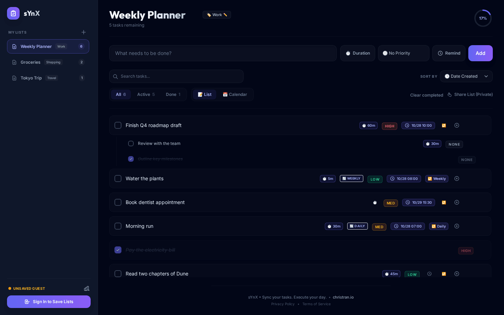
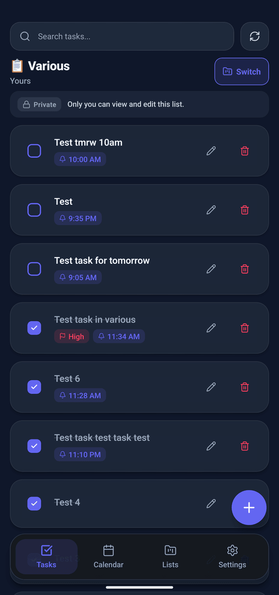
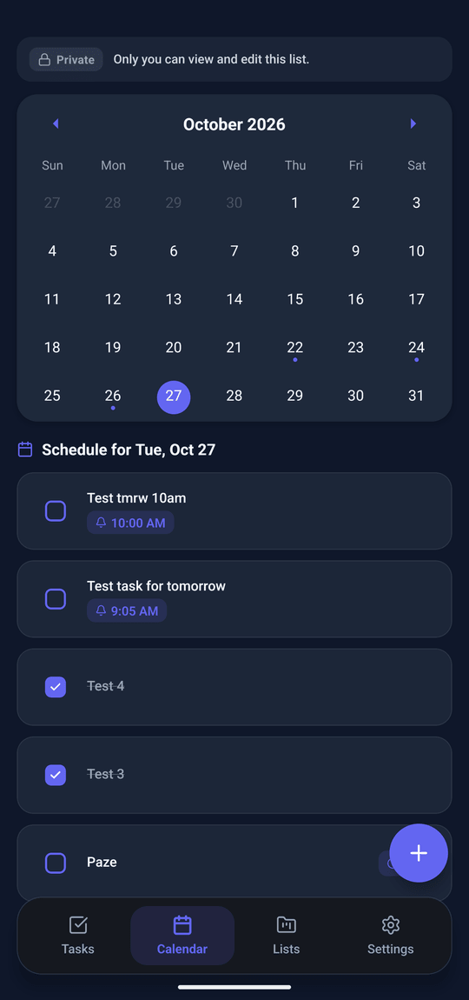
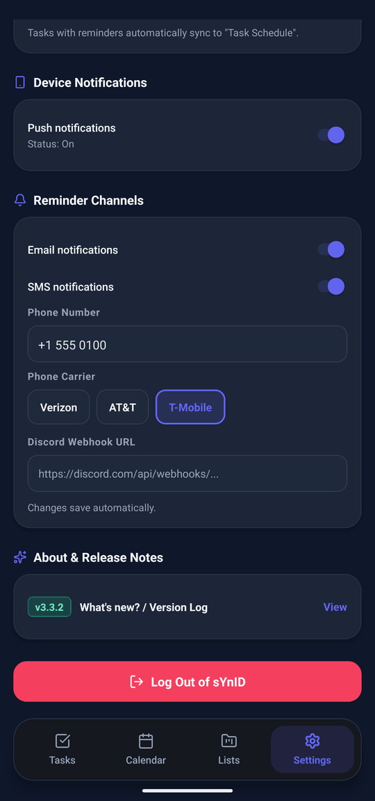
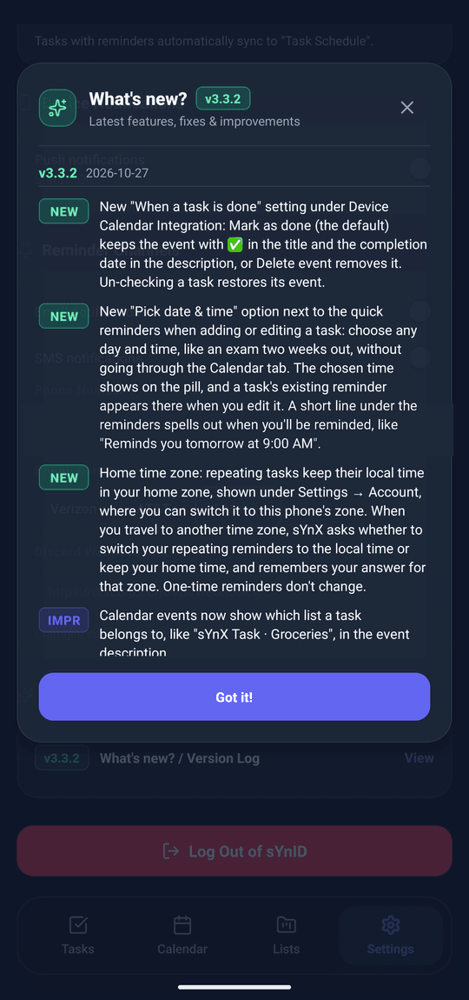
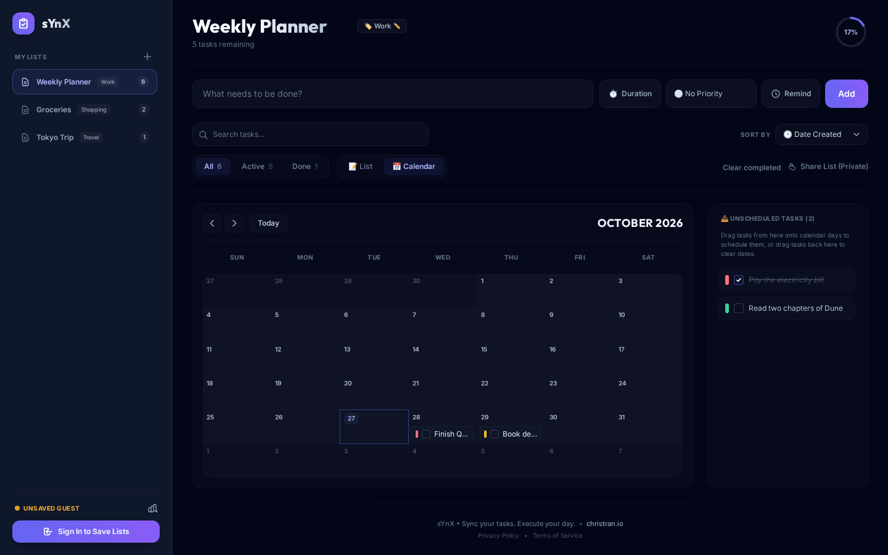
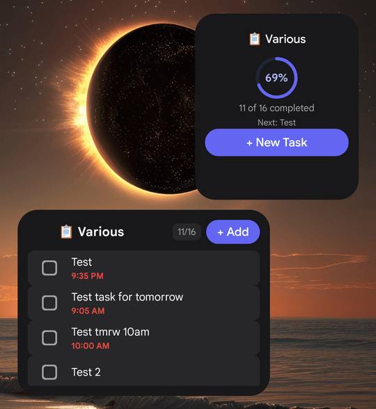

# sYnX

sYnX is a to-do list app for the web and Android. The web app is a Remix app on Cloudflare Workers with a Cloudflare D1 database. The Android app is built with Expo and React Native, and uses the same account and data through the web app's REST API. Both live in this repo.

Live at [synx.christran.io](https://synx.christran.io).



<table>
  <tr>
    <td></td>
    <td></td>
    <td></td>
    <td></td>
  </tr>
  <tr>
    <td align="center">Tasks</td>
    <td align="center">Calendar</td>
    <td align="center">Settings</td>
    <td align="center">What's New</td>
  </tr>
</table>

---

## Features

**Lists and tasks** (web and mobile)

* Multiple lists, each with a category: `Checklist`, `Study`, `Shopping`, `Movies`, `Work`, `Personal`, `Travel`, `Fitness`, or a custom one.
* Tasks with a priority (none, low, medium, high), an optional duration (`5m` to `60m` presets or a custom value), and subtasks nested under their parent task.
* Reminders, with quick presets or a picked date and time, and recurrence (daily, weekly, monthly). Repeating tasks keep their local clock time in your home time zone, including across daylight saving changes.
* Inline editing of task and list titles, search (including subtask text), filters (all, active, done), sorting by date created, priority, reminder time or name, and clearing completed tasks.
* A calendar view next to the list view. On the web you can drag unscheduled tasks onto a day.

**Sharing**

* Each list is Private, View-Only or Collaborative. Anyone with the link can open a View-Only list, and anyone with the link can edit a Collaborative one.
* Lists you open from someone else's link appear under "Shared with me", with the owner's display name. Emails are never shown.

**Accounts and guest mode**

* Sign-in goes through sYnID, an OpenAuth server at `auth.christran.io`, with PKCE. Sessions renew in the background.
* Without signing in, the web app works in guest mode. Guest lists are kept in the browser's local storage and move to your account when you sign in.

**Reminders and notifications**

* A cron trigger runs every minute and sends due reminders by email (Resend), text message (an email-to-SMS carrier gateway through Resend, or Twilio), Discord webhook, and push notification to your phones (Firebase Cloud Messaging).
* The web app can also show browser notifications while it's open.
* Reminder channels, your display name and your home time zone are set in Settings.

**Web extras**

* Five color themes: Midnight Indigo (default), Emerald Forest, Sunset Rose, Cyberpunk Neon and Light Pastel.
* A progress ring for each list, confetti when you finish the last task, and a What's New popup for each release.



For the Android app's extras, see [Mobile app](#mobile-app).

---

## Web app

| | |
|---|---|
| Framework | [Remix](https://remix.run/) 2.17 (on Vite 5) with React 19, running on [Cloudflare Workers](https://developers.cloudflare.com/workers/) with static assets |
| Database | [Cloudflare D1](https://developers.cloudflare.com/d1/) (`synx-db`, binding `DB`) |
| Styling | Tailwind CSS 3 |
| Auth | [OpenAuth](https://openauth.js.org/) client (`@openauthjs/openauth`) against sYnID |
| Validation | [Valibot](https://valibot.dev/) |
| Tooling | Wrangler 4, TypeScript 5.8, ESLint 9 (flat config), Vitest 4 with `@cloudflare/vitest-pool-workers` |

`server.ts` is the Worker entry. Its `fetch` handler serves the Remix app, and its `scheduled` handler is the every-minute reminder cron (`triggers.crons` in `wrangler.jsonc`).

### REST API (`/api/v1`)

The mobile app uses these routes. They expect a sYnID access token in an `Authorization: Bearer <token>` header.

| Route | Methods |
|---|---|
| `/api/v1/lists` | `GET`, `POST` |
| `/api/v1/lists/:id` | `GET`, `PUT`, `DELETE` |
| `/api/v1/lists/:id/share-mode` | `PUT` |
| `/api/v1/lists/:id/shared` | `DELETE` (remove from Shared with me) |
| `/api/v1/todos` | `GET`, `POST` |
| `/api/v1/todos/:id` | `PUT`, `DELETE` |
| `/api/v1/todos/:id/completed` | `POST` |
| `/api/v1/todos/:id/toggle` | `POST` |
| `/api/v1/todos/:id/mark-reminder-sent` | `POST` |
| `/api/v1/todos/clear-completed` | `POST` |
| `/api/v1/settings` | `GET`, `PUT` |
| `/api/v1/settings/time-zone` | `PUT` |
| `/api/v1/devices` | `POST` (register a push token), `DELETE` (unregister it) |

### Environment variables and secrets

Set these on the Worker in the Cloudflare dashboard, or locally in a `.dev.vars` file (gitignored). Only `DB` is needed to run locally. Each notification channel is skipped when its secret isn't set.

| Name | Used for |
|---|---|
| `DB` | D1 binding, set up in `wrangler.jsonc` |
| `OPENAUTH_ISSUER` | sYnID issuer URL (defaults to `https://auth.christran.io`) |
| `CLIENT_ID_MAP` | Optional JSON map from hostname to OAuth client ID (defaults to `synx`) |
| `SYNX_ALLOWED_CLIENT_IDS` | Optional comma-separated list of accepted token audiences (defaults to `synx`) |
| `RESEND_API_KEY` | Reminder emails and email-to-SMS |
| `TWILIO_ACCOUNT_SID`, `TWILIO_AUTH_TOKEN`, `TWILIO_FROM_NUMBER` | Text messages through Twilio, used when no carrier is set |
| `FIREBASE_SERVICE_ACCOUNT_JSON` | Push notifications through FCM |

---

## Mobile app

The Android app lives in [`mobile/`](mobile/). It's an Expo SDK 58 app (React Native 0.88, React 19.3) in the Expo project `synx`, owned by `chris-tran`, with the Android package `io.christran.synx`. It uses the production web app's `/api/v1` routes.

**Features**

* Tasks, Calendar, Lists and Settings tabs, with the same lists, tasks, subtasks, priorities, durations, reminders, recurrence and sharing as the web app.
* Sign-in with sYnID (PKCE) through the system browser. The session is kept in secure storage and renews in the background.
* Push notifications for reminders through Firebase Cloud Messaging. The phone's push token is registered with `/api/v1/devices` and removed when you sign out.
* Three Android home screen widgets: **Active List** (check off tasks), **Pinned List & Up Next**, and **Progress & Quick Add** (a progress ring and one-tap add). Checkoffs made while offline are queued and synced later, and a background task keeps the widgets up to date.
* Optional sync of tasks that have reminders to a device calendar you choose.
* An offline copy of your lists (TanStack Query, saved to AsyncStorage), light, dark and system themes, haptics, and deep links (`synx://` links and `synx.christran.io` list links, including a quick-add action).
* Home time zone support: when you travel, the app asks before switching your repeating reminders to the local time.



### Shared code and versions

* [`shared/`](shared/) holds code that both apps use: validation schemas, recurrence and time zone logic, list permissions, changelog types and widget snapshot logic. `mobile/scripts/sync-shared.js` copies it into `mobile/src/shared/`. The copy runs on `npm start`, `prebuild` and the EAS pre-install hook, and CI fails if it's out of date.
* The mobile version's single source of truth is `MOBILE_APP_VERSION` in [`shared/mobile-version.ts`](shared/mobile-version.ts). `cd mobile && npm run sync-version` copies it into `mobile/package.json` and `mobile/app.json`, and `mobile/app.config.js` sets Expo's `version` from it. EAS manages the Android `versionCode` remotely.
* The current version and its release notes are in the [mobile changelog](mobile/src/constants/changelog.ts).

### Local development

```bash
cd mobile
npm install
npm start           # expo start (syncs shared/ and the version first)
npm run android     # build and run the native Android app (expo run:android)
npm run typecheck
npm run doctor      # expo-doctor; needs Node 22.13 or newer
```

Run `npm run doctor` after any change to mobile dependencies and before a release. If package versions don't match the Expo SDK, fix them with `npx expo install --fix`.

Push notifications need `mobile/google-services.json`, which is gitignored. In EAS builds, `mobile/scripts/decode-google-services.js` writes it from the `GOOGLE_SERVICES_JSON_BASE64` environment variable.

### EAS builds

* [`mobile/.eas/workflows/android-preview.yml`](mobile/.eas/workflows/android-preview.yml) builds an installable Android preview APK (the EAS `preview` profile) on every push to `main` that touches `mobile/**` or `shared/**`, ignoring Markdown files. Pull requests never start a build.
* When the build finishes, `mobile/scripts/post-build-comment.js` comments on the merged pull request with a link to the build page, which has an Install button and a QR code. It needs the `SYNX_GITHUB_COMMENT_TOKEN` secret in the EAS `preview` environment.
* To skip the build, put `[eas skip]` in the commit message (or in the PR title, for squash merges).
* `mobile/eas.json` also has `development` and `production` (app bundle) profiles.

---

## Development

You need Node 22 or newer: Wrangler 4 requires it, and CI uses Node 22.

```bash
npm install
npx wrangler d1 migrations apply synx-db --local   # create the local D1 database
npm run dev                                        # Remix dev server on Vite, with the local D1
```

The local app runs in guest mode until you sign in. Signing in locally needs a sYnID client that allows your local callback URL.

| Script | What it does |
|---|---|
| `npm run dev` | Remix dev server (Vite), with the Cloudflare bindings from `wrangler.jsonc` |
| `npm run build` | Production build into `build/` |
| `npm run preview` | Build, then run it in the Workers runtime with `wrangler dev` |
| `npm start` | `wrangler dev` on an existing build |
| `npm run check` | Typecheck, build and `wrangler deploy --dry-run` |
| `npm run cf-typegen` | Regenerate `worker-configuration.d.ts` (binding types) |
| `npm run lint` | ESLint |
| `npm test` | Vitest |
| `npm run typecheck` | Web typecheck |
| `npm run typecheck:mobile-tests` | Typecheck the root tests that import mobile code, using the mobile types |
| `npm run deploy` | Build, apply D1 migrations to production, then deploy. Workers Builds runs this; don't run it by hand |

---

## Testing and CI

Tests live in [`test/`](test/) and run inside the Workers runtime with `@cloudflare/vitest-pool-workers`. Each test file gets its own D1 database, built from `migrations/`. The tests cover the web server code, `shared/` and parts of the mobile app.

[GitHub Actions](.github/workflows/ci.yml) runs these checks on every pull request and every push to `main`:

```bash
npm run lint
npm test -- --run --maxWorkers=2
npm run typecheck
npm run typecheck:mobile-tests
cd mobile && npm run typecheck
```

CI also checks that `mobile/src/shared/` and the mobile version files are in sync, and runs `expo-doctor` when `mobile/` or `shared/` changes. Dependabot opens weekly pull requests for production npm dependencies.

---

## Deploy and database migrations

The `to-do-list` Worker deploys through [Cloudflare Workers Builds](https://developers.cloudflare.com/workers/ci-cd/builds/), which is connected to this repo:

* **Pull requests and other branches** run `npx wrangler versions upload`. That uploads a version without deploying it. Preview URLs are turned off.
* **`main`** runs `npm run deploy`: build, apply any pending D1 migrations to production, then `wrangler deploy`.

### Database schema and migrations

The app stores its data in a Cloudflare D1 (SQLite) database named `synx-db`. The schema lives in numbered SQL files in [`migrations/`](migrations/), and Wrangler records which ones have run in a `d1_migrations` table inside the database. `migrations/0000_baseline.sql` is the full schema as it existed in production on Oct 27, 2026.

#### Change the schema

1. Create a new numbered migration file and write the SQL in it:
   ```bash
   npx wrangler d1 migrations create synx-db <short_name>
   ```
2. Apply it to your local dev database:
   ```bash
   npx wrangler d1 migrations apply synx-db --local
   ```
3. Run the tests. They build their database from `migrations/`, so they pick up the change automatically.

Rules:

* Never edit a migration that has already been applied. Fix mistakes with a new migration.
* Keep changes additive within a release (expand, then contract): add the new column or table first, ship code that uses it, and only drop the old one in a later release.
* Don't run DDL (`CREATE`/`ALTER`/`DROP`) from app code for new changes. Some older code still adds columns at runtime (`ensureUserProfileSchema`, `ensureCategoryColumn`); that is legacy and will be removed in a follow-up.

#### Production

Production migrations run in the deploy pipeline, not by hand. `npm run deploy` (what Cloudflare Workers Builds runs on every push to `main`) builds the app, applies any pending migrations to the remote database, then deploys the Worker. If a migration fails, the deploy stops before the new code goes live. To see which migrations production has applied (read-only):

```bash
npx wrangler d1 migrations list synx-db --remote
```

---

## Versioning and changelogs

The web and mobile apps have separate SemVer version lines: minor versions for features, patch versions for fixes, and major versions for breaking changes. The full rules, including when to bump and the release checklist, are in [`.claude/rules/versioning.md`](.claude/rules/versioning.md).

* **Web**: `WEB_VERSION` and the What's New entries are in the [web changelog](app/constants/changelog.ts). Bump it only for user-facing web changes.
* **Mobile**: `MOBILE_APP_VERSION` is in [`shared/mobile-version.ts`](shared/mobile-version.ts), and the release notes are in the [mobile changelog](mobile/src/constants/changelog.ts).
* Within each version, changelog items go NEW, then IMPR, then FIX. `test/changelog-order.test.ts` enforces this.

---

## Project structure

```
app/                 Remix app: web UI, server code, /api/v1 routes
  routes/            Pages ($id.tsx is the main list page), auth routes, API routes
  constants/         Web changelog and WEB_VERSION
server.ts            Worker entry: fetch handler and reminder cron
migrations/          D1 schema migrations
shared/              Code shared by web and mobile (copied into mobile/src/shared/)
mobile/              Expo / React Native Android app
  src/               Screens, components, widgets, services, API client
  scripts/           sync-shared, sync-version, google-services decode, EAS build comment
  plugins/           Expo config plugins (widget progress ring)
  .eas/workflows/    EAS Android preview build workflow
test/                Vitest tests (Workers runtime)
scripts/             PKCE flow check against a mock sYnID server
docs/screenshots/    README screenshots
graphify-out/        Code knowledge graph for coding agents
wrangler.jsonc       Worker config: D1 binding, cron trigger, assets
```

Rules for coding agents are in [`CLAUDE.md`](CLAUDE.md), `.claude/rules/`, `.cursor/rules/` and the other agent rule folders.
