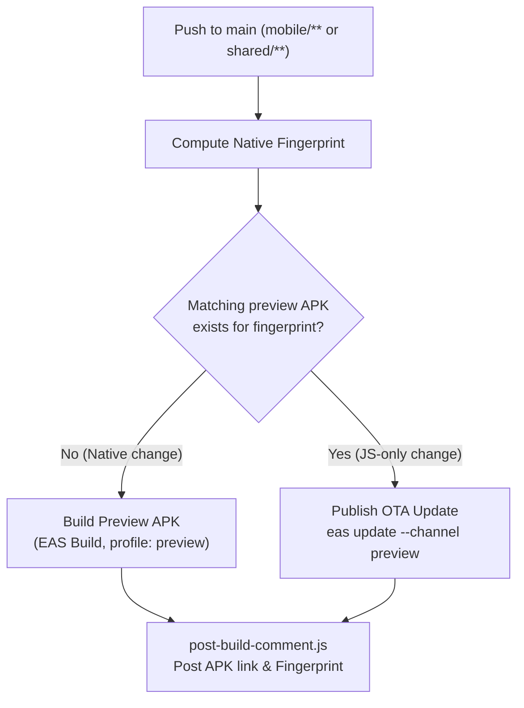
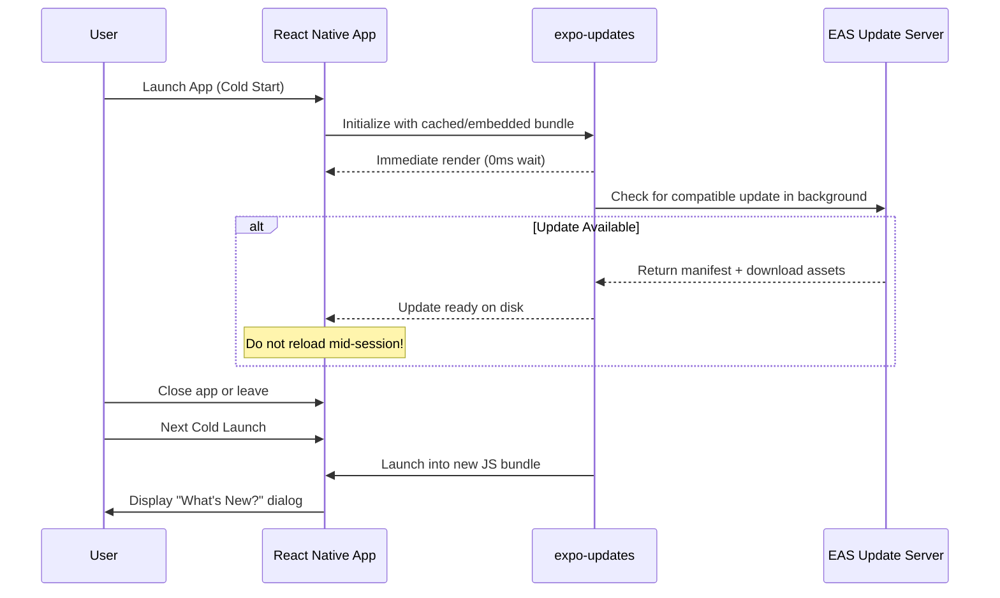
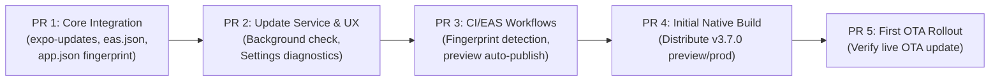

# Over-The-Air (OTA) Updates Architecture & Implementation Plan (`expo-updates`)

This document defines the architecture, operational guidelines, and rollout plan for Over-The-Air (OTA) JavaScript and asset updates for the sYnX mobile application using `expo-updates` and EAS Update.

It resolves **Issue #159** by establishing technical specifications and operational boundaries prior to introducing runtime dependencies or publishing OTA updates.

---

## 1. Overview & Goals

Over-The-Air (OTA) updates allow delivering JavaScript bundle updates, updated assets (images, icons), and style/logic enhancements directly to installed devices without requiring a full native binary compilation and store review cycle for every minor change.

### Primary Goals
- **Faster release cadence**: Deliver bug fixes, copy improvements, and UI refinements in minutes instead of waiting for full binary builds and manual store approval.
- **Save EAS build credits**: Avoid running 15–20 minute native builds for pure JavaScript changes on push to `main`.
- **Zero user disruption**: Updates download silently in the background and activate seamlessly on the next cold launch, avoiding mid-session resets that disrupt active task edits.
- **Fail-safe recovery**: Guarantee offline usability, automatic crash rollback to embedded binaries if an update fails, and manual rollback commands for release engineers.

---

## 2. Current State Assessment & Initial Package Prerequisite

### Current Mobile Setup
- **Expo SDK**: 58 (`expo: ~58.0.23`, `react-native: 0.88.1`, React 19.3.0).
- **Updates Module**: Neither `expo-updates` nor any OTA delivery mechanism is currently installed or configured in `mobile/package.json` or `mobile/app.json`.
- **Build Configurations**:
  - `mobile/eas.json` defines three build profiles: `development` (development client), `preview` (internal distribution APK), and `production` (Google Play App Bundle).
  - Version management uses remote EAS build counters (`cli.appVersionSource: "remote"`, `autoIncrement: true`).
- **Native Customizations**:
  - Android Home Screen Widgets via `expo-widgets` and `@expo/ui/jetpack-compose`.
  - Custom local config plugin: `mobile/plugins/withWidgetProgressRing.js` (generates native XML ring drawables into `android/app/src/main/res/drawable/`).
  - Pre-install / post-install native patch scripts: `mobile/scripts/patch-expo-widgets.js` (modifies native Kotlin sources in `node_modules/expo-widgets/`).
  - Native permissions: Push notifications (`POST_NOTIFICATIONS`), Calendar sync (`READ_CALENDAR`, `WRITE_CALENDAR`), boot receiver (`RECEIVE_BOOT_COMPLETED`), and vibration (`VIBRATE`).

### Prerequisite: Initial Native Package Required

> [!IMPORTANT]
> **OTA updates cannot reach existing installed binaries until a new native package is installed.**
> 
> `expo-updates` requires native code and native manifest configuration (`AndroidManifest.xml` meta-data tags and iOS `Expo.plist` properties) that only exist in binaries compiled with the `expo-updates` library included. Therefore:
> 1. Existing preview APKs or production builds cannot receive OTA updates.
> 2. The first release introducing `expo-updates` must be built and distributed as a full native package (`preview` APK and `production` AAB / IPA).
> 3. Subsequent compatible JavaScript and asset changes can then be delivered over the air.

---

## 3. Delivery Service Comparison & Recommendation

We evaluated **EAS Update** against a **Self-Hosted Update Server** built on Cloudflare Workers, R2, and D1.

| Dimension | EAS Update (Recommended) | Self-Hosted (Cloudflare Workers + R2 + D1) |
|---|---|---|
| **Operational Overhead** | Near-zero. Native EAS CLI commands (`eas update`, `eas update:rollback`). Managed manifest protocol and asset hosting. | High. Must build, host, and maintain a custom implementation of the Expo Updates v1 protocol specification. |
| **Pricing & Quotas** | Free tier includes **1,000 monthly active users (MAU)** receiving updates. Additional usage costs $0.005/update MAU or requires Pro ($29/mo). | Leverages sYnX's existing Cloudflare Workers + R2 storage. Essentially free for low-to-medium volume. |
| **Rollbacks & Rollouts** | Out-of-the-box support for instant server-side rollbacks (`eas update:rollback`) and percentage-based staged rollouts (`eas update:rollout`). | Requires custom database models, deployment metadata tables in D1, and custom percentage allocation logic. |
| **Security & Signing** | TLS transport encryption and EAS project-scoped credentials on Free tier. End-to-end RSA code signing requires EAS Paid tier. | Full end-to-end RSA private/public key code signing available on day one at zero extra cost. |
| **Tooling & CI** | Native integration with `eas build`, `eas update`, and `.eas/workflows/android-preview.yml`. | Custom build scripts using `npx expo export` + custom Wrangler R2 upload scripts. |

### Recommendation: EAS Update (Primary) with Cloudflare Migration Path

1. **Adopt EAS Update as the primary service**: Given sYnX's current phase and user base, EAS Update's 1,000 free MAU ceiling is ample. The native tooling, staged rollout support, and instant rollback capabilities eliminate months of custom infrastructure development.
2. **Documented Migration Path**: If sYnX exceeds the 1,000 MAU free tier limit or if uncompromised end-to-end code signing is required without an EAS subscription, the architecture can migrate cleanly to Cloudflare Workers + R2:
   - Export bundles via `npx expo export --platform [android|ios]`.
   - Store static assets and bundles in Cloudflare R2 behind the `synx.christran.io` CDN.
   - Implement the Expo Updates Protocol v1 endpoints (`/api/v1/updates/manifest`) on the existing Cloudflare Worker to serve signed multipart manifests from D1.

---

## 4. App Store Policy Constraints (iOS & Android)

Over-the-air updates must adhere strictly to Apple App Store and Google Play guidelines to avoid store suspension.

### Apple App Store (Guideline 2.5.2)
- Apple allows Over-The-Air updates of interpreted code (JavaScript and HTML5) **only** if the updates do not significantly alter the primary purpose or functionality of the application as reviewed and approved by App Review.
- **Rule**: Updates delivered over the air must remain within the to-do list, reminder, list sharing, calendar sync, and productivity domain of sYnX. Any new major business model or unrelated functionality requires a full store submission.

### Google Play Developer Program Policy (Device and Network Abuse)
- Google Play permits apps to download executable code (such as JavaScript) as long as it does not circumvent Google Play's security protections or modify the app's binary components outside the Play Store distribution mechanism.
- **Rule**: OTA updates must not inject native libraries, bypass Android permissions, or alter system-level behavior without Play Console review.

---

## 5. Runtime-Version Compatibility & Versioning Interaction

### The Versioning Conflict
Per [`.claude/rules/versioning.md`](../.claude/rules/versioning.md), sYnX mobile maintains `MOBILE_APP_VERSION` in `shared/mobile-version.ts` as the single source of truth (SSOT). On every new calendar day with mobile changes, `MOBILE_APP_VERSION` is bumped (e.g. `3.6.0` → `3.7.0`), which `mobile/app.config.js` injects into Expo `version`:

```javascript
// mobile/app.config.js
module.exports = ({ config }) => {
  const version = readMobileAppVersion();
  return {
    ...config,
    version, // Sets Android versionName / iOS CFBundleShortVersionString
  };
};
```

If we configured `runtimeVersion: { policy: "appVersion" }`, **every daily version bump would alter the native runtime version string**. Installed apps would immediately reject subsequent OTA updates because the update's runtime version would not match the binary's runtime version.

### Solution: `runtimeVersion: { policy: "fingerprint" }`

Expo's `@expo/fingerprint` generates a deterministic cryptographic hash of all files and configurations that actually affect the **native build runtime** (native dependencies, Android manifest configurations, iOS permissions, Gradle scripts, and config plugins).

Pure JavaScript code, UI components, icons, and user-facing version strings do **not** change the native runtime fingerprint.

#### Configuration in `mobile/app.json`:
```json
{
  "expo": {
    "updates": {
      "url": "https://u.expo.dev/cf164c52-5a77-472a-9120-768ab5499a2d",
      "checkAutomatically": "ON_LOAD",
      "fallbackToCacheTimeout": 0
    },
    "runtimeVersion": {
      "policy": "fingerprint"
    }
  }
}
```

#### `.fingerprintignore` Configuration
Create `mobile/.fingerprintignore` to explicitly ignore user-facing version files and pure app code while retaining native configuration assets:
```gitignore
# Pure JavaScript application code
src/**

# Versioning SSOT (changes daily, does not affect native runtime)
src/shared/mobile-version.ts

# Documentation and changelogs
src/constants/changelog.ts
```

> [!IMPORTANT]
> Native configuration assets (`mobile/assets/icon.png`, `mobile/assets/adaptive-icon.png`, `mobile/assets/splash.png`, `mobile/assets/notification-icon.png`) are purposefully **not** ignored. They are compiled into native Android resources (`res/mipmap-*`, `res/drawable-*`) during prebuild. Retaining them in the fingerprint calculation guarantees that any image edits to native launcher or splash resources safely bump the native fingerprint and force a new native binary package.

#### Special Case: Android Widgets (`expo-widgets`)
- **Runtime Layout Changes**: Modifications inside `mobile/src/widgets/CurrentListWidget.tsx` using Compose UI (`Text`, `Row`, `Column`) are bundled in JavaScript and **can** be updated over the air.
- **Native Ring Drawables & Prebuild Patches**: `mobile/plugins/withWidgetProgressRing.js` (generates XML ring drawables) and `mobile/scripts/patch-expo-widgets.js` (patches native Kotlin files) alter native files. Because they reside outside the ignore list, `@expo/fingerprint` will automatically detect any edits to them and generate a new fingerprint, safely forcing a new native build.

---

## 6. OTA vs. New Package Decision Rules

To ensure team members and release scripts know when an OTA update is permitted vs. when a new native package is mandatory:

| File / Component Path | Nature of Change | Release Channel |
|---|---|---|
| `mobile/src/screens/**`, `mobile/src/components/**` | React Native UI, layout, bug fixes, strings | **OTA Update** |
| `mobile/src/hooks/**`, `mobile/src/services/**` | Client sync, API queries, local logic | **OTA Update** |
| `shared/**` (except native validation rules) | Shared types, formatting, sort utilities | **OTA Update** |
| `shared/mobile-version.ts` | Daily SemVer bump (`MOBILE_APP_VERSION`) | **OTA Update** |
| `mobile/assets/**` (`icon`, `splash`, `adaptive-icon`) | Native compiled app icons, adaptive icons, splash screens | **New Native Package** |
| `mobile/src/assets/**` (if added) | Pure JS bundled UI illustrations and icons | **OTA Update** |
| `mobile/package.json` (`dependencies`) | Upgrading or adding native dependencies | **New Native Package** |
| `mobile/package.json` (`dependencies`) | Pure JS packages (e.g. `valibot`, `date-fns`) | **OTA Update** |
| `mobile/app.json` (`android.permissions`, `plugins`) | Native permissions or config plugins | **New Native Package** |
| `mobile/plugins/**` (`withWidgetProgressRing.js`) | Native drawable ring generator changes | **New Native Package** |
| `mobile/scripts/patch-expo-widgets.js` | Kotlin patches to `expo-widgets` | **New Native Package** |
| `mobile/google-services.json` | Firebase configuration change | **New Native Package** |

---

## 7. Channels, Build Profiles & Release Pipeline

### Channel & Profile Mapping
In `mobile/eas.json`:
- `development`: Maps to channel `development` (used with Expo Go / dev client).
- `preview`: Maps to channel `preview` (used for internal APK distribution and testing).
- `production`: Maps to channel `production` (used for Google Play Store / Apple App Store).

```json
{
  "cli": {
    "version": ">= 21.4.0",
    "appVersionSource": "remote"
  },
  "build": {
    "development": {
      "developmentClient": true,
      "distribution": "internal",
      "channel": "development"
    },
    "preview": {
      "autoIncrement": true,
      "distribution": "internal",
      "channel": "preview",
      "android": {
        "buildType": "apk"
      }
    },
    "production": {
      "autoIncrement": true,
      "channel": "production",
      "android": {
        "buildType": "app-bundle"
      }
    }
  }
}
```

### Fingerprint-Aware Workflow on Push to `main`

The current workflow (`mobile/.eas/workflows/android-preview.yml`) spends an EAS build credit on every push to `main`. With OTA updates:



1. **Calculate Fingerprint**: Run `@expo/fingerprint` in CI.
2. **Check Artifact Cache**: If an existing preview APK build on EAS has the exact same fingerprint, publish an OTA update to the `preview` channel (`eas update --channel preview --auto`).
3. **Fallback to Native Build**: If the fingerprint changed, trigger a full EAS build for `preview`.
4. **Pull Request Notification**: `post-build-comment.js` posts either:
   - *"Preview APK ready (v3.6.0)"* with the QR code link, or
   - *"Preview OTA update published (runtime: `abc1234`)"* indicating test devices will receive the update automatically on relaunch.

### Production Release Safeguards
- **Never auto-publish to production on push**: Production OTA updates are never published automatically by CI.
- **Set Rollout Limit at Publication Time**: Never publish to 100% of production users and then attempt to apply a rollout limit afterward. Exposure must be capped directly during the publish or promotion command:
  - **Per-Update Direct Publication with Rollout**:
    ```bash
    eas update --channel production --message "Production release v3.6.0" --rollout-percentage 20
    ```
    *(Users not included in the 20% rollout continue receiving the prior stable update).*
  - **Branch-Based Gradual Rollout (`eas channel:rollout`)**:
    When rolling out a new update branch incrementally on the production channel:
    ```bash
    eas channel:rollout production --action create --branch preview --percent 20 --runtime-version <fingerprint>
    ```
- **Progressing and Finalizing the Rollout**:
  - Increase rollout percentage:
    ```bash
    eas update:edit
    # or for branch-based rollout:
    eas channel:rollout production --action edit --percent 50
    ```
  - Finalize rollout (100%):
    ```bash
    eas update:edit # set to 100%
    # or for branch-based rollout:
    eas channel:rollout production --action end --outcome republish-and-revert
    ```
  - Revert / Cancel rollout:
    ```bash
    eas update:revert-update-rollout
    # or for branch-based rollout:
    eas channel:rollout production --action end --outcome revert
    ```

---

## 8. Update Check, Download & Activation Lifecycle

### Lifecycle Configuration
- **`checkAutomatically: "ON_LOAD"`**: The app checks for updates when launched.
- **`fallbackToCacheTimeout: 0`**: **Zero blocking time** on app launch. The app immediately renders the cached or embedded bundle. If an update is available, it downloads asynchronously in the background.



### Background & Manual Checks
1. **Throttled Foreground Check**: In `mobile/src/services/updates.ts`, listen to `AppState` transitions. If the app has been backgrounded for ≥6 hours, check for updates in the background.
2. **Never Force Mid-Session Reloads**: Never execute `Updates.reloadAsync()` while the user is actively working. This prevents losing unsaved `TaskModal` drafts, aborting active reminder edits, or interrupting `SettingsScreen` changes.
3. **Manual Control in Settings**:
   Under **About & Release Notes** in `SettingsScreen.tsx`:
   - Display a **"Check for updates"** button.
   - If a new update has downloaded and is waiting, show **"Update ready: Restart sYnX to apply"**.
   - If the user has unsaved settings edits (`settingsDirty`), the existing unsaved changes dialog protects their work before restarting.

---

## 9. Offline Startup, Failure Recovery, Rollbacks & Staged Rollouts

### Offline Startup
- Because `fallbackToCacheTimeout: 0`, the app launches without network connectivity in 0 ms.
- If network requests fail during the background update check, `expo-updates` fails silently without throwing unhandled exceptions.

### Bad Update Recovery (Automatic Native Crash Rollback)
- If an OTA bundle contains a catastrophic fatal error that crashes the JavaScript engine on launch, `expo-updates` native watchdog detects consecutive launch crashes.
- The runtime automatically reverts to the embedded binary bundle and flags `Updates.isEmergencyLaunch === true`.
- When `isEmergencyLaunch` is true, the app logs a diagnostic warning and ignores the bad update on subsequent launches.

### Server-Side Rollback & Rollback Directives
If a regression is discovered after publishing to `production`:
```bash
# Roll back to the embedded binary bundle
eas update:rollback --channel production

# Or republish a known good previous update
eas update:republish --from-update-id <good-update-id> --to-channel production
```
- **Client Rollback Handling**: When `eas update:rollback` is executed, Expo servers respond to `checkForUpdateAsync()` with `isAvailable: false` and `isRollBackToEmbedded: true`. The client update service detects this directive, calls `fetchUpdateAsync()`, sets `isUpdatePending: true` and `isRollBackToEmbedded: true`, and surfaces "Restart to Apply Rollback" in Settings.
- **Native Startup Download Bridging**: When an update is downloaded natively during startup (`checkAutomatically: "ON_LOAD"`), the client update service bridges Expo's native state machine via `Updates.addUpdatesStateChangeListener` and `Updates.latestContext`, immediately reflecting the pending update in Settings without requiring a redundant manual check.

---

## 10. Persistence & Backend API Compatibility

When devices may run different OTA updates or roll back to older bundles, local persistence and server APIs must remain strictly backward- and forward-compatible.

### 1. TanStack Query Cache (`REACT_QUERY_OFFLINE_CACHE`)
- Serialized in `AsyncStorage` via `@tanstack/query-async-storage-persister`.
- **Rule**: Never change existing query key tuple structures (`['todos', listId]`, `['lists']`, `['list_meta', listId]`) in an OTA update without providing cache-upgrade logic, or offline data will fail to deserialize.

### 2. Android Widget State (`pendingOps`)
- Widget checkoffs are persisted in Android `SharedPreferences` as `pendingOps` and drained via `drainAndReplayPendingWidgetOps()`.
- **Rule**: The JSON shape of `WidgetPendingOp` (`todoId`, `listId`, `completed`, `timestamp`) must remain strictly stable.

### 3. Backend API Compatibility (Cloudflare Workers & D1)
- Align with `CLAUDE.md` **Expand-and-Contract** schema migration rules:
  - Additive changes only: new columns must be optional with defaults.
  - Do not drop or rename API endpoints or database columns while older OTA versions or native binaries remain active in the wild.

---

## 11. Version Visibility, Support Diagnostics & Observability

To enable customer support and engineers to diagnose user issues accurately:

### 1. Settings "About & Release Notes" Card
Enhance the card in `mobile/src/screens/SettingsScreen.tsx`:
- **Display Version**: `MOBILE_VERSION` (e.g. `v3.6.0`, matching What's New).
- **Diagnostic Details**:
  - `Native Binary: 3.6.0 (Build 42)`
  - `Channel: production`
  - `Runtime: abc1234` (short fingerprint)
  - `Update: 7f8d1a2b` (or `Embedded`)
  - Emergency indicator: `⚠️ Safe Mode (Emergency Rollback)` if `Updates.isEmergencyLaunch`.

### 2. Client Diagnostic Headers (`apiClient`)
In `mobile/src/api/client.ts`, inject diagnostic headers on all API requests:
```typescript
config.headers['X-sYnX-Client-Version'] = MOBILE_APP_VERSION;
config.headers['X-sYnX-Binary-Version'] = Application.nativeApplicationVersion ?? 'unknown';
config.headers['X-sYnX-Runtime-Version'] = Updates.runtimeVersion ?? 'unknown';
config.headers['X-sYnX-Update-Id'] = Updates.updateId ?? 'embedded';
if (Updates.isEmergencyLaunch) {
  config.headers['X-sYnX-Emergency-Launch'] = '1';
}
```
*(Note: HTTP/2 normalizes header names to lowercase `x-synx-*` on the wire; Cloudflare Workers inspect them case-insensitively).*

### 3. EAS Update Dashboard Insights
Track active update adoption percentages, download error rates, and crash rates by update ID directly in the Expo dashboard.

---

## 12. Android & iOS Validation Matrix

Before rolling out OTA updates, perform this validation matrix on physical Android and iOS devices:

| Test Case | Procedure | Expected Result |
|---|---|---|
| **1. Compatible JS Update** | Publish a text/style change to `preview`. Launch app, wait 10s, close app, cold launch. | App immediately boots into new UI; "What's New" displays new version. |
| **2. Offline Cold Launch** | Turn on Airplane Mode. Cold launch app. | App boots immediately (0ms wait) from cache; no errors or unhandled rejections. |
| **3. Incompatible Runtime Rejection** | Publish update with dummy runtime version `incompatible-test`. Cold launch app. | App ignores update, continues running existing compatible bundle without crashing. |
| **4. Bad Update Native Rollback** | Publish update containing top-level `throw new Error("fatal")`. Cold launch app. | App crashes, triggers native watchdog, reverts to embedded bundle (`isEmergencyLaunch`). |
| **5. Settings Manual Restart** | Trigger manual check in Settings while `settingsDirty` is true. Tap "Restart to apply". | App warns about unsaved changes; upon confirmation, restarts cleanly into new bundle. |
| **6. Android Widget Sync** | Check off task in widget while running OTA bundle. | Op drains and syncs to API without regression. |

---

## 13. Phased Implementation Roadmap

This exploration will be followed by sequenced implementation pull requests:



### Phase 1: Dependency & Configuration Setup
- Install `expo-updates` compatible with SDK 58.
- Configure `app.json` (`updates`, `runtimeVersion: { policy: "fingerprint" }`).
- Configure `mobile/eas.json` (channels `development`, `preview`, `production`) and sync root `eas.json`.
- Add `mobile/.fingerprintignore`.

### Phase 2: Client Update Service & Settings UI
- Implement `mobile/src/services/updates.ts` (throttled background checks, state store).
- Update `mobile/src/screens/SettingsScreen.tsx` (About card diagnostics, manual check & restart button).
- Add `X-sYnX-*` diagnostic headers in `mobile/src/api/client.ts`.

### Phase 3: CI/EAS Automation
- Update `mobile/.eas/workflows/android-preview.yml` with fingerprint-aware OTA publishing vs. full APK builds.
- Update `mobile/scripts/post-build-comment.js` to report OTA update publishing on PRs.

### Phase 4: Initial Native Package Build & Verification
- Compile and distribute the new native binary package (`preview` APK and `production` AAB).
- Execute the Validation Matrix on physical Android and iOS devices.

### Phase 5: First Live Production OTA Release
- Verify live OTA rollout with staged percentage (`10%` → `100%`) using `eas update --rollout-percentage <N>` or `eas channel:rollout` and `eas update:edit`.
